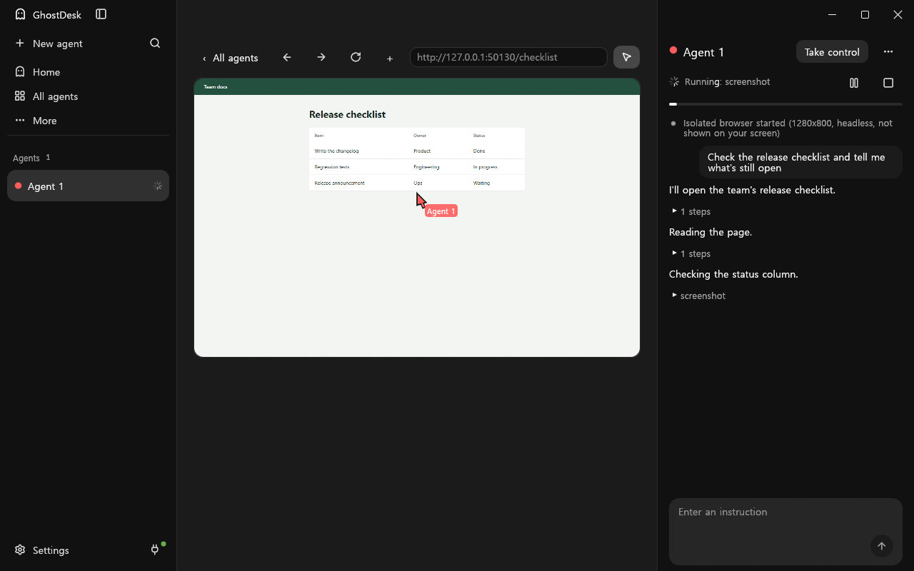
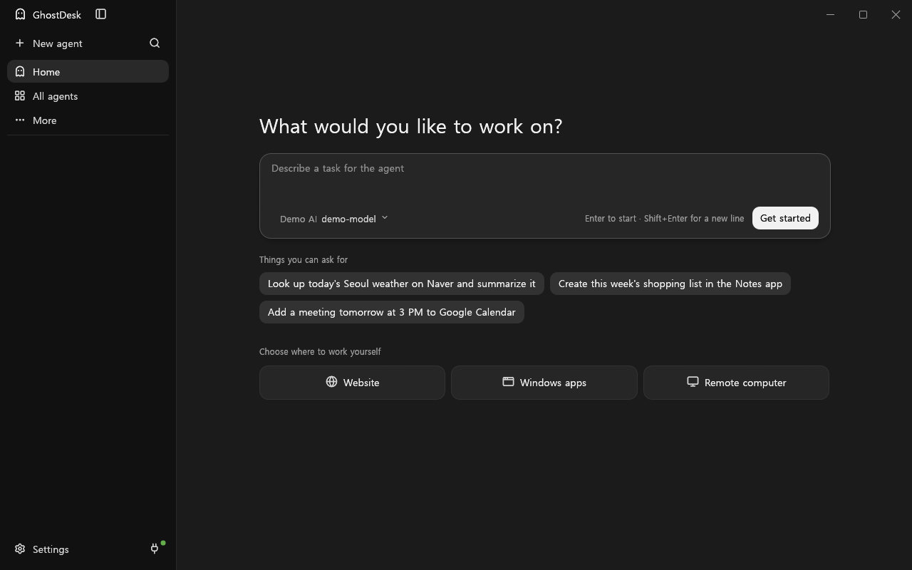
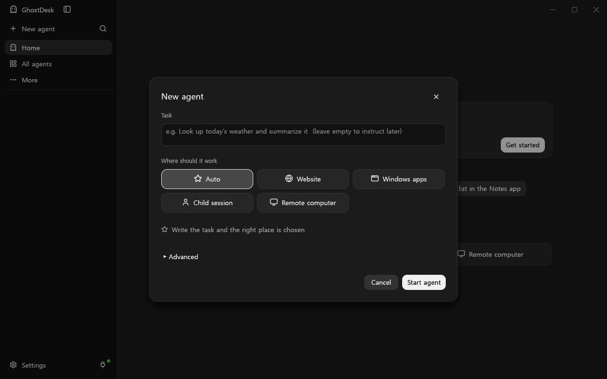
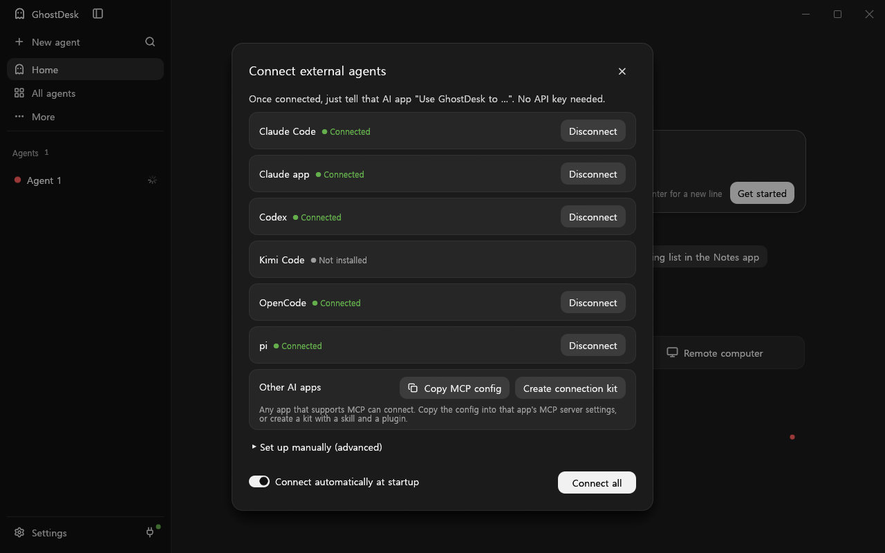
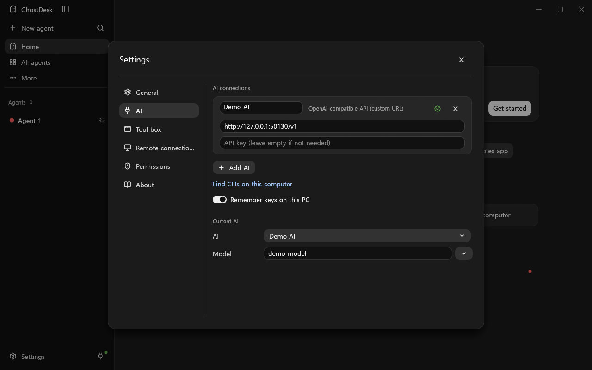

# GhostDesk

GhostDesk lets AI agents use websites and desktop apps while you keep using
your computer. Agents work in browsers and app windows that are never shown on
your screen, so your mouse and keyboard stay yours. Every click and keystroke
is mirrored live in the GhostDesk window, and you can take over a screen at any
time for things only a person should do, like signing in or two-factor prompts.



GhostDesk runs on macOS 13+ and Windows 10/11. It is written in Rust with
[egui](https://github.com/emilk/egui). Windows-specific differences (available
screen types, install location, building) are collected in the
[Windows](#windows) section at the end.

### Documentation quick links

* [Download](#download)
* [Usage](#usage)
* [Building](#building)
* [Connecting external agents](#connecting-external-agents)
* [Safety restrictions](#safety-restrictions)
* [Windows](#windows)
* [Code layout](#code-layout)

## Download

- **Windows x64:** [GhostDesk-Setup-0.15.2-windows-x64.exe](https://github.com/r2adkr/ghostdesk/releases/download/v0.15.2/GhostDesk-Setup-0.15.2-windows-x64.exe)

  Run the setup and click **Install**. It installs for your user only (no admin
  rights) to `%LOCALAPPDATA%\Programs\GhostDesk`, adds a Start menu shortcut
  (and a desktop one if you leave that on) and registers an uninstaller under
  Settings → Apps. Running a newer setup updates the installed copy and keeps
  your settings and workspaces. The installer is unsigned, so SmartScreen may
  warn you the first time (**More info** → **Run anyway**). If you update from a
  version older than the installer through the in-app update, the next launch
  adds the Start menu shortcut and the uninstaller entry by itself.

- **macOS (Apple Silicon, Intel):** [GhostDesk-0.15.2-macos-universal.dmg](https://github.com/r2adkr/ghostdesk/releases/download/v0.15.2/GhostDesk-0.15.2-macos-universal.dmg)

  Open the disk image and double-click GhostDesk.app: it installs itself to
  `~/Applications/GhostDesk.app` and reopens from there. The app is not
  notarized, so macOS blocks it the first time: open System Settings → Privacy
  & Security and click **Open Anyway** at the bottom. A newer installed app is
  never replaced by an older one. If you drag it into /Applications instead,
  that copy just opens the one in `~/Applications`, which is the only copy
  that runs.

Older builds and release notes are on the [releases page](https://github.com/r2adkr/ghostdesk/releases).

When a new version is released, a notice shows up in the sidebar. **Update**
downloads the build for your OS and CPU and swaps it in; **Restart** applies it.

The first launch shows a short illustrated guide. You can bring it back from
Settings.

## Usage

There are two ways to give GhostDesk a task.

**From GhostDesk itself.** Type the task into the home composer and press
Enter. This uses your own API key: open Settings → AI connections, click **+**,
pick a provider and paste the key. Claude, OpenAI, Gemini, Grok, OpenRouter and
Mistral are built in, any number of OpenAI-compatible endpoints (DeepSeek,
Groq, LM Studio, …) can be added by URL, and a local Ollama works too. The
model and thinking depth are picked from the button under the composer.

**Use an existing CLI login.** In Settings → AI connections, choose **Find CLIs
on this computer**, or add **Claude Code CLI** / **Codex CLI**. GhostDesk checks
the installed CLI's login and loads its models without copying credentials or
requiring another API key. Sign in first with `claude auth login` or `codex login`,
then use **Check connection again**. A custom executable path can be set when
automatic detection misses an installation. Codex uses its account model catalog;
Claude shows the CLI's `sonnet`, `opus`, and `haiku` aliases and accepts a model
ID entered by hand. CLI versions must support the required non-interactive and
structured-output options; unsupported versions show an error.

To start, enter a task on **Home** or choose **New agent** on the **All agents**
screen. Then choose where the agent works: a website, a specific app, or a
remote computer. **Auto** uses an app if the task names one and starts on the
web otherwise.

<p> </p>

**From an AI app you already use.** The Claude app, Claude Code, Codex, Kimi
Code, OpenCode and pi are connected automatically when GhostDesk starts. Ask
them to "use GhostDesk to …"; no API key is needed. When a task needs clicking
around a website or app, the agent will also offer GhostDesk on its own. Apps
not on that list (Cursor, Gemini CLI, Windsurf, …) can be connected from
**Connections → Other AI apps** by copying the MCP config or generating a
connection kit.

<p> </p>

**Keyboard.** Press Cmd+K (Ctrl+K on Windows) to jump to a screen, an agent or an
action. Cmd+1 to 4 switch between Home, All agents, Teams and Usage, Cmd+N
starts an agent, Cmd+B hides or shows the sidebar, Cmd+, opens Settings and
Cmd+. pauses every agent at once (press it again to resume them; agents you
have taken over are left alone). Hold Cmd to see each shortcut next to its menu item.

**Recent tasks.** Home lists the last five tasks you gave; one click puts a task
back in the composer. **Clear history** next to the list removes it from this
computer. An agent's **⋯** menu has **Copy conversation**, which copies its
instructions, replies, actions and errors as plain text for reporting a problem.

**Usage tab.** Shows what agents used over the last 7, 30 or 90 days, by day and
by agent. Agents inside GhostDesk report real token counts. Outside agents
(Claude Code, Codex, …) use their own AI service, so GhostDesk counts what it
can see: screens opened, actions, and screenshots sent or left out, with a rough
estimate of the tokens that saved.

The UI is available in Korean, English, Japanese and Chinese.

## Building

```bash
cargo build --release
./target/release/ghostdesk            # GUI
./target/release/ghostdesk --mcp      # MCP server for external agents (stdio, starts the GUI if needed)
```

GhostDesk requires Rust 1.95 or newer. With rustup, the version pinned in
`rust-toolchain.toml` is installed automatically.

Run `cargo test` for local tests, including a real local OpenSSH SFTP fixture on
macOS. With Python 3 and Codex installed, `python3 scripts/check_cli_isolation.py`
exercises the production CLI adapter against a localhost Responses fixture and
checks that no native CLI tools are exposed. It uses synthetic authentication
and makes no paid model requests. Pass `--codex /absolute/path/to/codex` when the
executable is outside PATH. An optional live Codex model smoke test is separately
marked ignored in `src/cli.rs` and requires explicit opt-in.

## Agent screens (macOS)

| Screen | How it is hidden | Logins | Effect on your screen |
|---|---|---|---|
| Website | Headless browser cloned from a Chrome/Edge/Brave/Whale profile; input only through CDP | Optionally clones your logins | None |
| Electron apps (VS Code, Antigravity, OpenCode, …; starred in the list) | A separate instance that is transparent, click-through, unfocused and kept out of the Dock; input only through CDP | Optionally clones app data | None. Verified to cause zero cursor/focus changes and zero visible windows |
| Other Mac apps (TextEdit, Calculator, KakaoTalk, …) | Hidden windows captured with ScreenCaptureKit; clicks as Accessibility (AX) actions; keys posted to that process only | Same app. Using your running app requires consent (it is hidden while in use) | None. The menu bar shows the screen-recording indicator while capturing |
| Virtual display (experimental, requires consent) | Attaches an invisible monitor and opens the app window there, so clicks, drags and right-clicks use real pixels | Same app | The monitor is attached at the outer edge of the arrangement, so the cursor can wander onto it. Detached when done |
| Separate account session | Drives an entire background session of a dedicated macOS account through a helper | Signed in separately in that account | None |
| Remote computer | VNC (RFB), for a dedicated Mac, VM or Linux box | That computer's | None. Never connects to this Mac's own Screen Sharing |

A few things that help while agents work:

- Queue follow-up tasks with **Next task** on the detail screen; they start as
  soon as the current one finishes.
- Set **Max steps** to **Unlimited** under Advanced to remove the step limit.
- **Take control** hands the screen to you at any time.
- **Screen wall** shows every agent's screen side by side (full screen with
  F11, or ⌃⌘F on macOS; Esc closes it). Agents waiting for you or stopped on an
  error get a yellow or red border.
- The virtual cursor glides along a real path instead of teleporting, so it is
  easy to follow what the agent is about to do.

## Connecting external agents

On launch, GhostDesk installs itself to `~/Applications/GhostDesk.app` and
registers as an MCP server with Claude Code, the Claude app, Codex, Kimi Code,
OpenCode and pi. The Claude app needs one restart to pick it up.

- Where it registers: Claude Code via `claude mcp add --scope user`, the Claude
  app in `claude_desktop_config.json`, Codex in `~/.codex/config.toml`, Kimi
  Code in `~/.kimi-code/mcp.json`, OpenCode in `~/.config/opencode/opencode.json`
  (or `opencode.jsonc` if that is the only file; files with comments are left
  alone), and pi in `~/.pi/agent/mcp.json`. Formatting, comments and other
  servers are preserved, and each file is backed up to `.ghostdesk-backup`
  before it is changed.
- pi has no built-in MCP support, so run `pi install npm:pi-mcp-adapter` once.
  The adapter disconnects idle servers, which would also close GhostDesk
  screens, so the entry includes `"lifecycle": "lazy-keep-alive"`.
- Check status, disconnect, or turn off auto-connect from the **Connections**
  dialog, or from a terminal with `ghostdesk --connect` / `ghostdesk --disconnect`.
- For apps not on the list, use **Connections → Other AI apps**:
  - **Copy MCP config** copies a standard `mcpServers` entry to paste into the app, or
  - **Create connection kit** writes an MCP config (`ghostdesk.mcp.json`), a
    skill (`skills/ghostdesk/SKILL.md`) and a Claude-format plugin
    (`claude-plugin/`) to your Downloads folder. From a terminal:
    `ghostdesk --export-kit [dir]`.

To register by hand:

```bash
claude mcp add ghostdesk -e GHOSTDESK_CLIENT_NAME="Claude Code" -- "/Applications/GhostDesk.app/Contents/MacOS/ghostdesk" --mcp
```

```json
"ghostdesk": { "command": "/Applications/GhostDesk.app/Contents/MacOS/ghostdesk", "args": ["--mcp"] }
```

```toml
[mcp_servers.ghostdesk]
command = "/Applications/GhostDesk.app/Contents/MacOS/ghostdesk"
args = ["--mcp"]
```

Kimi Code and pi use the same `mcpServers` format as the JSON above. OpenCode
puts the command, as an array, under `mcp`:

```json
"mcp": { "ghostdesk": { "type": "local", "command": ["/Applications/GhostDesk.app/Contents/MacOS/ghostdesk", "--mcp"], "enabled": true, "timeout": 30000 } }
```

The tools are `desk_open`, `desk_action` (click, type, scroll; returns a
screenshot. Pass several steps in `actions` to run them in order with a single
screenshot at the end; `wait_change` waits for the screen to change and
`fill_at` replaces a field's content), `desk_browser` (reads a page as a short numbered list of
what can be clicked or typed into, then `click`, `fill` and `select` by number
or by name, plus `text`, `find`, `links`, `wait_for`, navigation and tabs; it
returns text, not screenshots, which is far cheaper), `desk_app` (app
menus and accessibility elements; `find` and `label` pick elements by name
without reading the whole tree), `desk_list`, `desk_close`, and `team` and
`team_task` for [teams](#teams). The
`desk_open` `mode` is one of `web`, `web_login`, `app`, `app_login`,
`app_running`, `app_vdisplay`, `session` or `remote` (`app_current_session`
instead of `app_vdisplay` on Windows); agents pick the one that fits the task.

To keep token use low, only actions that change the picture return a
screenshot, a screenshot identical to the last one is left out, and tab lists
are sent only when they change. Pass `screenshot: true` to see the screen.
With `actions`, put `screenshot` either on the call (it covers the whole batch)
or on individual steps (any `true` returns an image, all `false` return none).
It has to be `true` or `false`; anything else is rejected with the position of
the bad value.

Numbers from `desk_browser` `read` stay valid while the page is the same. If a
page swaps a control for an identical new one (search boxes often do this once
you start typing), the number moves to the new control, as long as exactly one
element matches.
Screens opened by external agents are marked with a plug icon and show the
virtual cursor. The control socket is
`~/Library/Application Support/GhostDesk/control.sock` with mode 0600.

### SSH work and requested result files

If both computers have GhostDesk, open **Settings → Remote connections → Share
this computer’s connection info** on the computer doing the work. Check the
suggested address and services, then choose **Copy connection info**. On the
requesting computer, paste it into **Home → Remote computer**. Review the
destination and start the agent. The card contains the address, username and
selected ports. Enter a VNC password on the requesting computer when required.
SSH uses that computer’s verified host keys and SSH key or agent. The two
computers need a network route to each other and the selected services must
be enabled. You can edit the address for a VPN or a forwarded port.

Under **Home → Remote computer → Manual setup**, choose **Commands & files (SSH)** to
work over SSH, or **VNC + SSH** to also control the screen. In combined mode,
an empty SSH host uses the VNC host. Enter the port in its own field.

In **Settings → Remote connections**, save a named connection with a host, port and optional
username and private key path. Use **Edit** to change or delete a connection.
In the new-agent window, pick its name under **Saved SSH connections**.
Editing the loaded fields applies those changes to this run.

System OpenSSH `ssh` and `sftp` must be installed. SSH keys, the SSH agent and
OpenSSH host aliases are supported. Verify the host key and working key login
in a terminal first: unknown or changed keys are never accepted automatically.

Ask the agent to run a remote command or to bring back a specific result file.
Files are received only when requested, one absolute remote file path at a
time, under `Downloads/GhostDesk/<workspace>/` on the computer running GhostDesk.
The detail view lists received files with **Open file** and **Open folder**.
Existing files are never replaced, and failed transfers leave no result file.
SSH-only tasks show execution logs instead of a desktop screen. Cancelling SSH
closes the local connection; a remote child job may keep running, so check the
remote host before retrying a command that changes data.

External agents use `desk_open(mode="ssh", host=..., port=22, username=...,
identity_file=...)`, then `desk_remote(desk_id=..., action="execute",
command=..., timeout_seconds=120)` or `action="receive", remote_path="/absolute/file"`.
For VNC plus SSH, use `mode="remote"` and a separate `ssh` object containing
`host`, `port`, `username` and optional `identity_file`. The returned `local_path`
belongs to the GhostDesk computer; an MCP client running on another computer
does not automatically receive an additional copy there.

Settings → General → **Allow experimental features** records consent once for
experimental features such as virtual displays. Ordinary app, account and remote
connection permissions remain separate. Turning it off restores individual
experimental confirmations.

For login continuity, give `desk_open` the same `workspace` on later visits.
`web_login` accepts a detected `browser_profile` ID (for example `Profile 1`)
or an unambiguous profile name. Unknown or ambiguous browser/profile choices
are refused instead of using another account. `refresh_login: true` in
`web_login` or `app_login` replaces the workspace's cloned data from the
original; omit it to keep the existing clone. A browser clone whose original
source cannot be verified needs a new workspace or an explicit refresh.

Browser and Electron confirmation/prompt dialogs wait for an explicit answer.
Use `desk_browser` or `desk_app` with `action: "dialog"` to read the current
dialog, then `action: "respond_dialog"` with its `id`. Browser/JavaScript
responses require `accept: true|false` and optionally `prompt_text`.
Electron also requires the returned `source` (`javascript` or `native`);
native message boxes take a zero-based `response` button index. File dialogs
continue to provide their existing notes. A stale ID cannot answer a new dialog.

## Teams

When one job is bigger than one agent, put several agents on a team. A team is a
shared work board: a goal, notes everyone can read, and tasks that one agent at a
time can claim. Create teams in the **Teams** screen (or let an agent create one),
then tell each AI app something like "Join GhostDesk team 'Jeju trip' as the
researcher". The Teams screen shows who joined with which role, who is on which
task, the results of finished tasks and every note, and you can add notes and
tasks or reopen and delete them there. Right-click a team in the list to rename
or delete it; deleting asks for confirmation first.

To use a team with an API or CLI model configured inside GhostDesk, select
**Start team agent** on the team's board or choose a team in **New agent**.
You can add a role for that agent. It can read the board, claim and complete
tasks, and share notes with any other member of the same team.

**Team screens** on a team's board opens a screen wall with only that team's
members' screens. In **All agents**, the screen wall and the sidebar, a member's
screen carries a blue tag with its team and role (for example `Jeju trip ·
research`).

- External agents use two MCP tools. `team` (`list`, `create`, `join` with a `role`,
  `read`, `note`, `goal`, `leave`, `delete`) and `team_task` (`add`, `claim`,
  `done` with a `result`, `release`). Joining returns the goal, all tasks,
  active file claims, and the latest 30 notes. `read` with `before` pages back.
- For shared code, reserve exact repository-relative paths before editing with
  `claim_files` and release them with `release_files` on `team` (external MCP)
  or `team_board` (app agents). A request either reserves all paths or reports
  the existing owner. Agents can edit different files at the same time. The
  team board shows each reserved path and its owner. Claims clear when an agent
  leaves or an app agent finishes or returns to idle after an interruption. Reservations coordinate team agents
  through these tools.
- A task belongs to the agent that claimed it until it is done or released. When
  an agent disconnects, it leaves its teams and its claimed tasks open again.
- Screens stay per agent; a team shares what agents know and who does what, not
  input on one screen.
- An agent can create a team on its own, but deleting one needs your approval
  in the GhostDesk window. In the Teams screen, deleting opens a confirmation
  that shows how many notes and tasks go with it.
- Teams, notes and tasks are kept in `teams.json` in the data folder and survive
  a restart (members don't, so claimed tasks are open again after one).

## Safety restrictions

- Cloning your logins, launching a Mac app (not isolated), using a running app,
  virtual displays and remote connections all wait for you to click **Allow**
  in the GhostDesk window. The Dock icon bounces to get your attention.
- External requests cannot open Terminal, Script Editor, Automator, Shortcuts,
  Keychain Access, Passwords, System Settings, Finder or Activity Monitor.
- GhostDesk itself can only be opened as a fresh `mode=app` instance (with
  approval), and that instance uses an empty data folder (`nested/<name>`), so
  it never touches your settings, keys, connections or approvals. It cannot be
  reached through the running window or a login clone. This is still blocked
  entirely on Windows.
- A screen can only be driven by the connection that opened it, and it closes
  when that connection drops. External input waits while you are in control or
  the agent is paused.
- Workspaces with cloned logins and empty workspaces have separate names, so
  there is no way to reopen a clone without approval.
- In Electron screens, the agent's cmd+c/x/v are blocked. The system clipboard
  is yours.
- In Windows app screens, some apps still write to the system clipboard on
  their own (Character Map does when you pick a character). GhostDesk keeps a
  copy of your clipboard in memory and puts it back right away when that
  happens. The copy is never written to disk, logged or sent anywhere.
  `desk_open` tells the agent about this when it opens a Windows app.

## Permissions (macOS)

Websites, Electron apps, remote computers and external connections need no
extra permissions.

Other Mac apps need Accessibility and Screen Recording. While either is off the
sidebar shows a notice; **Settings → Permissions → Allow** brings up the macOS
prompts one at a time. Turn GhostDesk on from the prompt's **Open System
Settings** button. Screen Recording takes effect after a restart.

The installed copy is signed with a certificate GhostDesk creates on your Mac
(kept in its own keychain, `~/Library/Keychains/ghostdesk-signing.keychain-db`),
so permissions stay on after restarts and updates. The first launch after
switching from an older version reopens once, and the two permissions have to
be turned on one more time. If GhostDesk is missing from the Screen Recording
list, **Settings → Permissions** has a link that opens that page and shows the
app in Finder so you can add it with **+**.

For a separate account session, follow **How to set it up** in the app
(create a dedicated account, install the helper LaunchAgent, and grant
permissions inside that account).

External connections point at `~/Applications/GhostDesk.app`; other copies
hand over to it when opened.

## Data

- Workspaces, including cloned cookies and app data, live in
  `~/Library/Application Support/GhostDesk/workspaces/<name>`. Delete them
  whenever you like. With **Settings → General → Tidy up finished screens**
  on (the default), a screen an outside agent closed leaves the lists after
  about 90 seconds and its scratch workspace (one opened without a name) is
  deleted; workspaces an agent named and cloned logins are kept.
- Usage history is kept per day for 120 days in `usage.json`.
- On macOS, API keys are never written to disk. Enter them in Settings each
  launch or pass them through environment variables such as `ANTHROPIC_API_KEY`,
  `OPENAI_API_KEY` or `GEMINI_API_KEY`. Everything else (providers, models,
  endpoints) is kept in `prefs.json`.

## Testing

```bash
cargo test                                   # unit tests
./target/debug/ghostdesk --selftest          # browser (empty temporary profile)
./target/debug/ghostdesk --selftest-electron # hidden VS Code with an empty profile, watching for any effect on your screen
./target/debug/ghostdesk --selftest-native   # hidden TextEdit/Calculator with the same watch
./target/debug/ghostdesk --selftest-session  # session helper RPC (fake platform)
./target/debug/ghostdesk --selftest-vdisplay --yes   # attaches a real virtual monitor and drives TextEdit (only with consent)
ANTHROPIC_BASE_URL=http://127.0.0.1:<fake-server> ./target/debug/ghostdesk --agent-test "task"   # agent loop
```

GitHub Actions builds and runs the unit tests on Windows and macOS for every
push and pull request.

## Limitations

- Hidden Electron instances need the Node inspector fuse enabled. Discord, the
  Claude app and Unity Hub do not work.
- Other Mac apps run in hidden windows, so dragging, right-clicking and opening
  pop-up menus do not work, and Cmd shortcuts are performed as menu actions.
- Capture and input in a real background account session have not been
  verified on hardware yet (only against a fake platform).
- The VNC client does not implement the session-selection step of macOS Screen
  Sharing. Use it only with a dedicated Mac or VM.
- Agents act with your real accounts. They are told to ask before sending
  messages, paying or deleting things, but keep an eye on anything important.

## Windows

The same GUI and MCP server run on Windows 10/11. Tested on Windows 11 x64;
ARM64 has build settings only. This section lists only what differs from
macOS.

### Building and running

1. Install Rust 1.95+ (https://rustup.rs, default `x86_64-pc-windows-msvc`) and
   the "Desktop development with C++" workload from Visual Studio Build Tools.
2. Build:
   ```powershell
   cargo build --release
   .\target\release\ghostdesk.exe              # GUI
   .\target\release\ghostdesk.exe --connect    # install and connect Claude Code, the Claude app, Codex, Kimi Code, OpenCode, pi
   ```

- The C runtime is linked statically (`.cargo/config.toml`), so copying
  `ghostdesk.exe` alone to another PC is enough.
- It is a console program because of MCP (stdio) and the command-line modes,
  but launching it from Explorer shows only the GUI: Windows 11 24H2+ honors
  `consoleAllocationPolicy=detached` in the manifest, and older versions
  relaunch themselves without a console.
- One window per user. Launching it again brings the existing window to the
  front.

### Screen types (Windows)

| Screen | How it is hidden | Logins | Effect on your screen |
|---|---|---|---|
| Website | Headless browser cloned from a Chrome, Edge (incl. Beta/Dev/Canary), Brave, Whale, Vivaldi or Chromium profile; input only through CDP | Optionally clones your logins. Quit the source browser first: while it runs the cookie file is locked and the clone fails, naming the process that holds it | None |
| Electron apps (VS Code, Cursor, …) | A separate instance placed off-screen, without a taskbar button or focus; input only through CDP. In-app drag and drop stays inside the page. Console windows the app opens are hidden, and it is killed as soon as any window shows up on screen | Optionally clones app data (quit the app first) | None |
| Other Win32 apps (KakaoTalk, Character Map, …) | Window kept off-screen and captured with PrintWindow. Clicks and keys are sent as messages to that window only, elements are driven through UI Automation, and Ctrl shortcuts run as menu accelerators. Newly launched apps are kept off the system clipboard with a Job object | Same app. Using your running app requires consent (it is moved off-screen while in use and restored afterwards) | None |
| Remote computer | VNC (RFB), for a dedicated PC or VM | That computer's | None. A VNC server on this PC requires the "dedicated machine" confirmation, and external requests show a warning in the approval dialog |

- **Child session (PiP):** drives a whole separate Windows session on the same
  PC and account. Pick it under New agent; the first time, **Enable child
  sessions** asks for administrator approval (UAC). Only one child session can
  be connected system-wide, so agents take turns on it: the first one keeps it
  until its screen closes, and the others wait in line (their status shows who
  they wait for). External agents wait up to 40 seconds, then are told who has
  it so they can pick another mode or try again. The same applies on macOS to
  each dedicated account's separate session.
- **Signing in to the child session:** it signs in to this PC as you once more,
  so Windows may show a **Windows Security** prompt when it connects. Enter your
  account's **password** (for a Microsoft account, the Microsoft account
  password, user name `MicrosoftAccount\you@example.com`); a PIN, fingerprint
  or face (Windows Hello) doesn't work there. Check **Remember me** so it
  doesn't ask again. If *Settings → Accounts → Sign-in options → For improved
  security, only allow Windows Hello sign-in for Microsoft accounts on this
  device* is on, turn it off first. Smart-card-only accounts can't use child
  sessions. The full guide is under **New agent → Child session → How to set it
  up**. Installed apps and files are shared, but using the
  same browser profile concurrently or staying signed in to every app is not
  guaranteed. Use this mode for Microsoft Store apps such as the new Windows
  Notepad, Calculator and Paint, which cannot run in hidden app mode. External
  agents use `desk_open(mode="session")`; GhostDesk asks for approval before
  opening it.
- Windows child sessions support `desk_app` actions `list_windows`,
  `switch_window`, `ui_tree`, `press`, `set_value`, `read`, `focus`, `select`
  and `choose`. IDs remain valid until the next `ui_tree`. Use screenshots and
  keyboard shortcuts for menus; `menus` and `menu` are only available in regular app mode.
  The child helper must also be updated for these actions. Clipboard sharing
  with the user's desktop is disabled on new child-session connections.
- The child-session helper starts from HKCU `RunOnce`, so it needs an
  administrator account (including one normally used with standard rights).
  On a standard account the helper will not start even if another administrator
  approves UAC ([Microsoft docs](https://learn.microsoft.com/en-us/troubleshoot/windows-client/shell-experience/standard-user-cannot-run-commnad-via-runonce)).
  Capture, Korean multiline text, tabs, emoji and immediate Save have been
  verified in the new Notepad on Windows 11 x64.
- For long text in a child session, inspect a screenshot after focusing the
  input field or changing its selection, then type in a separate call. Native
  Edit/RichEdit fields use a synchronous edit after that observation. Other
  controls, and key/click-to-type batches without an intervening screenshot,
  keep queued keyboard input; inspect the result before saving or submitting.
  After upgrading, save documents in the child session, sign out of that
  session and reconnect so its helper also runs the new version.
- Virtual displays are macOS-only. On Windows, put a VNC server in something
  like a Hyper-V VM and connect to it as a remote computer.
- Not supported in Windows app mode: Microsoft Store (UWP/MSIX) apps (including
  the new Notepad, Calculator and Paint on Windows 11), console programs, apps
  that need elevation, system tools such as Explorer, Control Panel and Task
  Manager, right-click, opening combo boxes or date pickers (including F4; use
  `app_control`'s choose), dragging anywhere other than scroll bars and
  sliders, Ctrl shortcuts without a menu accelerator, and menus or shortcuts on
  a window behind a modal dialog. Copy and paste go through GhostDesk's
  internal clipboard and never touch the system clipboard.
- A window used through **Attach to my running app** (requires consent) is
  restored to its original position and state afterwards, including snap
  layouts and "maximize on restore". If GhostDesk crashes, it restores them on
  the next launch.
- Hidden Electron instances need the Node inspector fuse enabled (not Discord).
  Electron apps installed from the Microsoft Store (Skype, the Claude app, …)
  do not work either.
- Shortcuts are Ctrl-based. A `cmd+…` from the agent is turned into `ctrl+…` on
  website, Electron and Windows app screens (VNC is left alone). In Electron
  and Windows apps, keys that open menus (Alt alone, F10, Shift+F10, Alt+letter
  without other modifiers, Alt+Space, the Menu key) are blocked; use
  `desk_app`'s menu actions instead. Combinations such as Shift+Alt+F pass
  through.
- Website screens refuse network paths like `file://server/share` or
  `\\server\share` so your Windows credentials are never sent to that server.
  App paths from external requests are checked the same way.

### Using the current account's logins on a hidden desktop (Windows)

Turn on **New agent → Windows app → Use current account logins (hidden
screen)** and pick an app. GhostDesk launches it on a hidden desktop of the
same Windows account, with the app's own profile and saved logins. Electron
apps launched this way run as regular Windows apps instead of being cloned and
driven through CDP.

- This changes your real account data. Logins are never copied elsewhere and
  passwords are never read.
- It refuses to start if the same app is already running. Quit it, including
  from the tray, and try again. GhostDesk never closes it for you or attaches
  to its window.
- If the app cannot be started on the hidden desktop, you get an error; it does
  not silently fall back to the off-screen window mode.
- Not every app keeps its login. Store/UWP apps, elevated apps, protected
  screens and some GPU apps do not work, and logins from other Windows users or
  held only in memory are not carried over. The app may ask you to sign in
  again.

From MCP (using the original data requires approval in the GhostDesk window):

```json
{"mode":"app_current_session", "app":"Visual Studio Code"}
```

### Connecting external agents (Windows)

On launch (or with `ghostdesk.exe --connect`), GhostDesk installs itself to
`%LOCALAPPDATA%\Programs\GhostDesk\ghostdesk.exe` and registers in:

| Client | Location |
|---|---|
| Claude Code | `claude mcp add --scope user` (edits `%USERPROFILE%\.claude.json` directly if the CLI is missing or fails; honors `CLAUDE_CONFIG_DIR`) |
| Claude app | Microsoft Store build: `%LOCALAPPDATA%\Claude-Data\claude_<id>\claude_desktop_config.json`; installer build: `%APPDATA%\Claude\claude_desktop_config.json`. Quit it fully from the tray icon and restart to apply |
| Codex | `%CODEX_HOME%\config.toml` or `%USERPROFILE%\.codex\config.toml` |
| Kimi Code | `%KIMI_CODE_HOME%\mcp.json` or `%USERPROFILE%\.kimi-code\mcp.json` |
| OpenCode | `%XDG_CONFIG_HOME%\opencode\opencode.json` or `%USERPROFILE%\.config\opencode\opencode.json` (`opencode.jsonc` if that is the only file) |
| pi | `%PI_CODING_AGENT_DIR%\mcp.json` or `%USERPROFILE%\.pi\agent\mcp.json`. Requires `pi install npm:pi-mcp-adapter` |

- Other apps are connected from **Connections → Other AI apps**, the same as on
  macOS (`ghostdesk.exe --export-kit [dir]`; defaults to Downloads and opens
  Explorer when done). The `command` in the config is the install path above.
- Installing over a running `ghostdesk.exe` moves the old file aside as
  `ghostdesk.exe.old-*` and swaps in the new one. Leftovers are cleaned up on
  the next install.
- The control channel is the named pipe `\\.\pipe\GhostDesk-control-<user SID>`
  instead of a Unix socket. Its ACL admits only the same user, remote clients
  are rejected, and both ends verify that the peer is the same user. A
  low-integrity process (such as a sandbox) that creates a pipe with the same
  name first is rejected too.
- `ghostdesk.exe` loads DLLs only from the system directory, so a DLL with the
  same name in your Downloads folder is never picked up.
- In PowerShell, npm's `claude.ps1` swallows `--`, so use `claude.cmd` or
  `claude.exe` when registering by hand:
  ```powershell
  claude.cmd mcp add --scope user ghostdesk -e "GHOSTDESK_CLIENT_NAME=Claude Code" -- "$env:LOCALAPPDATA\Programs\GhostDesk\ghostdesk.exe" --mcp
  ```
- External requests cannot open: Command Prompt, PowerShell, Terminal, WSL,
  script hosts and abusable system tools (mshta, rundll32, regsvr32, certutil,
  …), Registry Editor, Control Panel, Settings, Services, Task Manager,
  Explorer, remote-assistance tools, password managers, and GhostDesk itself.

### Data (Windows)

- Workspaces and settings live in `%LOCALAPPDATA%\GhostDesk\`
  (`workspaces\<name>`, `settings.json`), never in the roaming profile
  (`%APPDATA%`).
- Browser and app modes need no extra permissions. Only enabling child sessions
  the first time requires administrator approval (UAC).

### Testing (Windows)

```powershell
cargo test
.\target\debug\ghostdesk.exe --selftest --browser=edge     # browser (empty temporary profile; name or executable path)
.\target\debug\ghostdesk.exe --selftest-native             # off-screen Character Map + built-in test window; checks cursor, focus and clipboard are untouched
.\target\debug\ghostdesk.exe --selftest-session            # child-session status + pipe round trip with a fake helper (no settings changed, no real input)
.\target\debug\ghostdesk.exe --selftest-electron           # hidden VS Code with an empty profile (requires VS Code)
```

## Code layout

| Path | Purpose |
|---|---|
| `src/app.rs`, `src/app/*` | egui UI (home, new agent, list and detail, screen wall, settings, connections, approval dialog, guide) and theme |
| `src/cursor.rs` | Virtual cursor (motion paths; click, drag, scroll and typing effects) |
| `src/agent.rs` | Agent loop, task queue, screen setup |
| `src/desk.rs` | Common interface over all screen types |
| `src/browser.rs`, `src/cdp.rs` | Headless browser (CDP) |
| `src/electron.rs` | Hidden Electron instances |
| `src/native.rs`, `src/macos/*` | Hidden macOS apps (ScreenCaptureKit capture, Accessibility, per-process input), permissions |
| `src/winapp/*` | Windows apps (off-screen windows, PrintWindow capture, message input, UI Automation, menu accelerators, watchdog) |
| `src/platform/*` | OS differences (paths, process groups/Job objects, control socket/pipe, shortcut translation, capability flags, Win32 helpers) |
| `src/session.rs`, `src/winapp/child.rs` | Helper RPC, capture and input for macOS dedicated accounts and Windows child sessions |
| `src/vdisplay.rs` | Experimental CGVirtualDisplay monitors |
| `src/install.rs` | Install (`~/Applications`, or `%LOCALAPPDATA%\Programs\GhostDesk` on Windows), auto-connecting AI apps, macOS app packaging |
| `src/update.rs` | Checks the latest GitHub release, downloads the build for this OS and CPU, verifies its SHA-256, swaps it in and restarts |
| `.github/workflows/ci.yml` | Windows and macOS build and unit tests for every push and PR |
| `.github/workflows/release.yml` | On a `v*` tag, builds the Windows x64 exe, the macOS universal zip and SHA256SUMS.txt and publishes the release (notes come from the tag message) |
| `build.rs`, `windows/ghostdesk.exe.manifest` | Windows executable manifest (no console when launched from Explorer) |
| `src/rfb.rs` | VNC (RFB) client |
| `src/control.rs`, `src/mcp.rs` | Control socket and MCP server for external agents |
| `src/kit.rs` | Connection kit for unlisted apps (MCP config, skill, plugin; the skill is generated from the instructions and tool list in `mcp.rs`) |
| `src/llm.rs` | Claude, OpenAI-compatible, Gemini and other AI APIs |
| `assets/tour/` | Screenshots for the first-run guide (the app captures its own window) |
| `assets/readme/` | English screenshots for this README, captured the same way with the UI set to English |
| `packaging/macos/` | App icon and the .dmg window (background, layout); `swift packaging/macos/make-art.swift` redraws the art |
| `src/team.rs`, `src/app/teams.rs` | Teams: shared boards (goal, notes, claimable tasks) for agents working together, and their screen |
| `src/licenses.rs`, `assets/third-party-licenses.json` | License page in Settings → About: GhostDesk's license and every open-source package built in |

## License

GhostDesk is released under the [Apache License 2.0](LICENSE).

The open-source packages built into the app, with their licenses, are listed in
**Settings → About → License**. The list is generated from Cargo.lock; after
changing dependencies, regenerate it with
`GHOSTDESK_UPDATE_LICENSES=1 cargo test third_party_list_is_current`
(the test fails while it is out of date).
