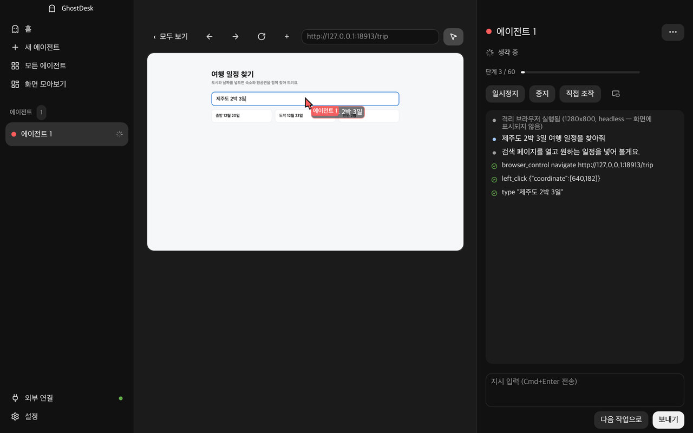
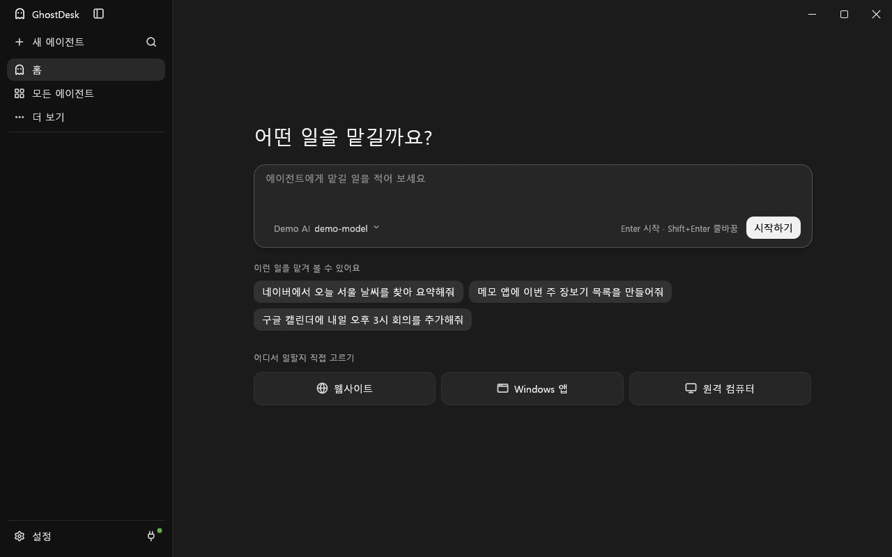
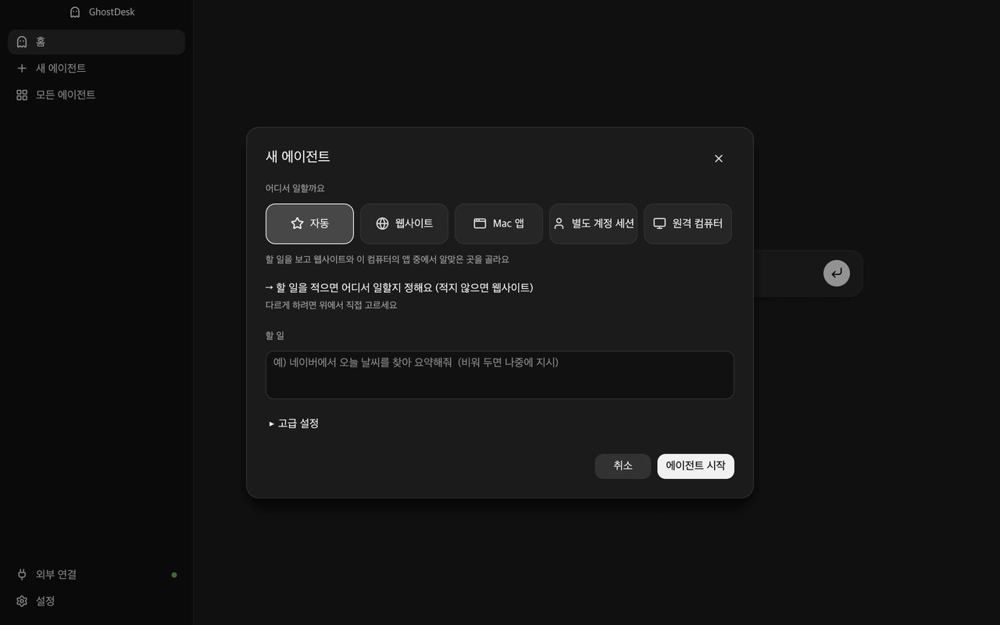
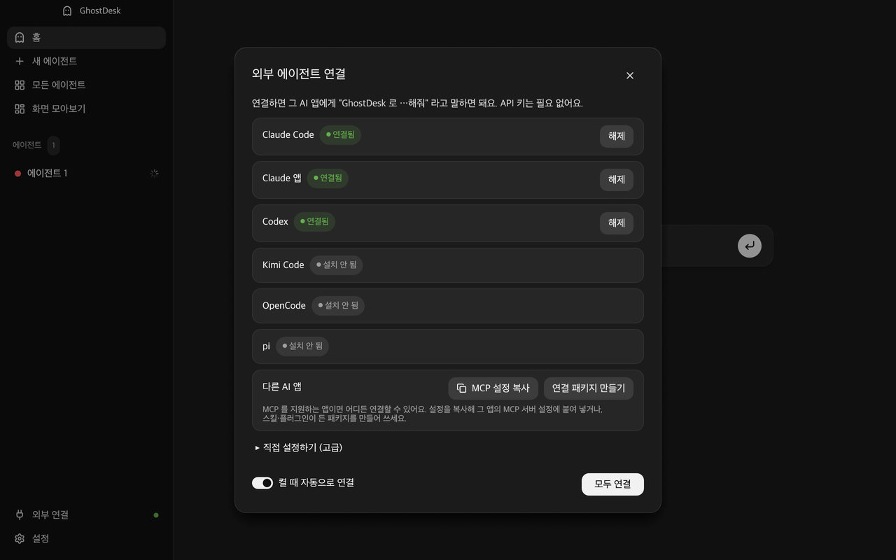
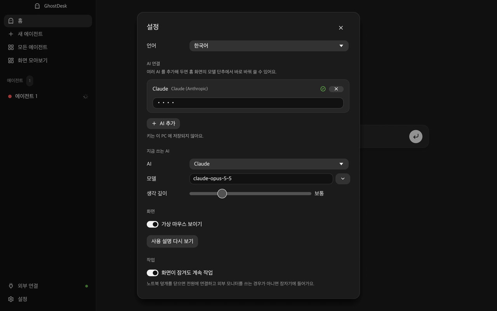

# GhostDesk

AI 에이전트한테 웹사이트나 앱 일을 시켜 두고, 그동안 나는 내 컴퓨터를 그냥 쓰려고 만든 앱입니다.
에이전트는 화면에 보이지 않는 브라우저나 앱 창에서 일하고, 마우스와 키보드는 계속 내 차지입니다.
뭘 누르고 뭘 입력하는지는 GhostDesk 창에서 그대로 보입니다. 로그인이나 2단계 인증처럼 사람이 해야 하는 건 그 화면을 넘겨받아 직접 하면 됩니다.



macOS 13 이상, Windows 10/11 에서 돌아갑니다. Rust 와 egui 로 만들었습니다.
Windows 쪽에서 다른 점(쓸 수 있는 화면 종류, 설치 위치, 빌드)은 맨 아래 [Windows](#windows) 에 따로 적었습니다.

## 내려받기

- Windows x64: [GhostDesk-0.5.0-windows-x64.exe](https://github.com/r2adkr/ghostdesk/releases/download/v0.5.0/GhostDesk-0.5.0-windows-x64.exe)
  받아서 실행하면 끝입니다. 설치 과정은 없습니다. 서명이 없는 파일이라 처음엔 SmartScreen 경고가 뜰 수 있습니다.
  이미 깔려 있는 상태에서 새로 받은 exe 를 실행하면, 떠 있던 옛 GhostDesk 를 닫고 설치본(`%LOCALAPPDATA%\Programs\GhostDesk\ghostdesk.exe`)을 새 버전으로 바꾼 뒤 그걸 띄웁니다. 설치본이 더 새 버전이면 건드리지 않습니다.
- macOS (Apple Silicon, Intel): [GhostDesk-0.5.0-macos-universal.zip](https://github.com/r2adkr/ghostdesk/releases/download/v0.5.0/GhostDesk-0.5.0-macos-universal.zip)
  압축을 풀어 GhostDesk.app 을 응용 프로그램 폴더에 넣으세요. 공증을 안 받은 앱이라 처음엔 열리지 않는데,
  시스템 설정 → 개인정보 보호 및 보안 맨 아래의 '그래도 열기'를 한 번 누르면 그다음부터는 그냥 열립니다.
  이미 GhostDesk 가 깔려 있는 상태에서 새로 받은 앱을 압축 푼 자리에서 바로 열면, 떠 있던 옛 GhostDesk 를 닫고 설치된 앱(`~/Applications/GhostDesk.app`)을 새 버전으로 바꾼 뒤 그걸로 다시 엽니다. 설치된 쪽이 더 새 버전이면 건드리지 않습니다.

새 버전이 나오면 사이드바에 알림이 뜹니다. '업데이트'를 누르면 지금 OS 와 CPU 에 맞는 파일을 받아 바꿔 두고, '다시 시작'하면 적용됩니다.

처음 켜면 사진 몇 장짜리 사용 설명이 한 번 나옵니다. 다시 보고 싶으면 설정에 있습니다.

## 쓰는 법

일을 맡기는 방법은 두 가지입니다.

**GhostDesk 안에서 바로.** 홈 입력 칸에 할 일을 적고 Enter. 이때는 내 API 키가 필요합니다.
설정 → AI 연결에서 + 를 눌러 회사를 고르고 키를 넣으면 됩니다. Claude, OpenAI, Gemini, Grok, OpenRouter, Mistral 이 있고,
DeepSeek·Groq·LM Studio 같은 OpenAI 호환 API 는 주소별로 여러 개 넣어 둘 수 있습니다. 내 PC 의 Ollama 도 됩니다.
모델과 생각 깊이는 입력 칸 아래 버튼에서 바꿉니다.

'새 에이전트'에서 웹사이트, 특정 앱, 원격 컴퓨터 중 어디서 일할지 직접 고를 수도 있습니다.
기본값인 '자동'으로 두면 할 일에 앱 이름이 있으면 그 앱에서, 없으면 웹에서 시작합니다.

<p> </p>

**이미 쓰는 AI 앱에서.** Claude 앱, Claude Code, Codex, Kimi Code, OpenCode, pi 는 GhostDesk 를 켜면 알아서 연결됩니다.
그 앱에 "GhostDesk 로 …해줘" 라고 하면 되고, API 키는 필요 없습니다. 굳이 GhostDesk 를 말하지 않아도 화면을 눌러야 하는 일이면 에이전트가 GhostDesk 로 할지 먼저 물어봅니다.
목록에 없는 앱(Cursor, Gemini CLI, Windsurf 등)은 '외부 연결 → 다른 AI 앱'에서 설정을 복사하거나 연결 패키지를 만들어 붙이면 됩니다.

<p> </p>

화면 언어는 한국어, 영어, 일본어, 중국어 중에서 고릅니다.

## 직접 빌드하기

```bash
cargo build --release
./target/release/ghostdesk            # GUI
./target/release/ghostdesk --mcp      # 외부 에이전트용 MCP 서버 (stdio, 필요하면 GUI 를 띄움)
```

Rust 1.95 이상이 필요합니다. rustup 을 쓰면 `rust-toolchain.toml` 에 적힌 버전을 알아서 받습니다.

## 에이전트가 일하는 화면 (macOS)

| 화면 | 어떻게 숨기나 | 로그인 | 내 화면에 미치는 영향 |
|---|---|---|---|
| 웹사이트 | Chrome/Edge/Brave/Whale 프로필을 복제한 headless 브라우저, 입력은 CDP 로만 | 원하면 내 로그인 복제 | 없음 |
| Mac 앱 중 Electron 앱 (VS Code, Antigravity, OpenCode 등, 목록에 별표) | 따로 띄운 인스턴스를 투명·클릭 통과·포커스 없음·Dock 없음으로 숨겨 실행, 입력은 CDP 로만 | 원하면 앱 데이터 복제 | 없음. 커서·포커스 변화와 보이는 창이 0 인 것을 확인함 |
| 그 밖의 Mac 앱 (텍스트 편집기, 계산기, 카카오톡 등) | 숨긴 창을 ScreenCaptureKit 으로 찍고, 클릭은 접근성(AX) 동작, 키 입력은 그 프로세스에만 | 같은 앱. 실행 중인 내 앱을 쓰려면 동의 필요(작업하는 동안 숨겨짐) | 없음. 찍는 동안 메뉴 막대에 화면 기록 표시가 뜸 |
| 가상 디스플레이 (실험, 동의 필요) | 안 보이는 모니터를 잠깐 붙이고 그 위에 앱 창을 띄워 실제 픽셀로 클릭·드래그·우클릭 | 같은 앱 | 모니터 배치 맨 바깥에 붙으므로 커서가 넘어갈 수 있음. 끝나면 뗌 |
| 별도 계정 세션 | 에이전트 전용 macOS 계정의 백그라운드 세션 전체를 헬퍼로 조작 | 그 계정에서 따로 로그인 | 없음 |
| 원격 컴퓨터 | VNC(RFB) 접속. 에이전트 전용 Mac, VM, Linux 용 | 그 컴퓨터 것 | 없음. 이 Mac 자신의 화면 공유에는 접속하지 않음 |

작업하면서 쓸 만한 것들:

- 상세 화면의 '다음 작업으로'에 일을 쌓아 두면 지금 일이 끝나자마자 이어서 합니다.
- 고급 설정에서 최대 단계를 '무제한'으로 두면 단계 수 제한 없이 갑니다.
- '직접 조작'을 누르면 언제든 내가 넘겨받습니다.
- '화면 모아보기'는 모든 에이전트 화면만 크게 모아 보여 줍니다 (전체 화면은 F11, macOS 는 ⌃⌘F, 닫기는 Esc). 내 답을 기다리거나 오류가 난 에이전트는 노란색·빨간색 테두리로 표시됩니다.
- 가상 마우스는 순간이동하지 않고 실제 경로를 따라 움직여서, 무엇을 하려는지 눈으로 따라가기 쉽습니다.

## 외부 에이전트 연결

GhostDesk 를 켜면 `~/Applications/GhostDesk.app` 에 자기를 설치하고, 이 Mac 의 Claude Code, Claude 앱, Codex, Kimi Code, OpenCode, pi 에 MCP 서버로 등록합니다.
Claude 앱은 한 번 다시 켜야 합니다.

- 등록 위치: Claude Code 는 `claude mcp add --scope user`, Claude 앱은 `claude_desktop_config.json`, Codex 는 `~/.codex/config.toml`, Kimi Code 는 `~/.kimi-code/mcp.json`,
  OpenCode 는 `~/.config/opencode/opencode.json`(`opencode.jsonc` 만 있으면 그 파일, 주석이 있으면 손대지 않음), pi 는 `~/.pi/agent/mcp.json`.
  서식·주석·다른 서버 설정은 그대로 두고, 고치기 전에 `.ghostdesk-backup` 으로 백업합니다.
- pi 는 MCP 를 기본으로 지원하지 않아서 `pi install npm:pi-mcp-adapter` 를 한 번 해 줘야 합니다. 이 확장은 쉬는 서버를 끊는데, 끊기면 GhostDesk 화면도 닫히기 때문에 `"lifecycle": "lazy-keep-alive"` 를 같이 넣어 둡니다.
- 연결 상태 확인, 해제, 자동 연결 끄기는 '외부 연결' 창에서 합니다. 터미널에서는 `ghostdesk --connect` / `ghostdesk --disconnect`.
- 목록에 없는 앱은 '외부 연결 → 다른 AI 앱'에서
  - 'MCP 설정 복사'로 표준 `mcpServers` 설정을 복사해 그 앱에 붙여 넣거나,
  - '연결 패키지 만들기'로 내려받기 폴더에 MCP 설정(`ghostdesk.mcp.json`), 스킬(`skills/ghostdesk/SKILL.md`), Claude 형식 플러그인(`claude-plugin/`)을 만듭니다. 터미널에서는 `ghostdesk --export-kit [폴더]`.

손으로 등록하려면:

```bash
claude mcp add ghostdesk -e GHOSTDESK_CLIENT_NAME="Claude Code" -- "/Applications/GhostDesk.app/Contents/MacOS/ghostdesk" --mcp
```

```json
"ghostdesk": { "command": "/Applications/GhostDesk.app/Contents/MacOS/ghostdesk", "args": ["--mcp"] }
```

```toml
[mcp_servers.ghostdesk]
command = "/Applications/GhostDesk.app/Contents/MacOS/ghostdesk"
args = ["--mcp"]
```

Kimi Code 와 pi 는 위 JSON 과 같은 `mcpServers` 형식이고, OpenCode 는 `mcp` 아래에 명령을 배열로 씁니다.

```json
"mcp": { "ghostdesk": { "type": "local", "command": ["/Applications/GhostDesk.app/Contents/MacOS/ghostdesk", "--mcp"], "enabled": true, "timeout": 30000 } }
```

도구는 `desk_open`, `desk_action`(클릭·입력·스크롤, 결과로 스크린샷. `actions` 에 여러 동작을 넣으면 순서대로 하고 끝에 한 번만 찍음), `desk_browser`(주소 이동·탭), `desk_app`(앱 메뉴·접근성 요소), `desk_list`, `desk_close` 입니다.
`desk_open` 의 `mode` 는 `web`, `web_login`, `app`, `app_login`, `app_running`, `app_vdisplay`, `session`, `remote` 이고(Windows 는 `app_vdisplay` 대신 `app_current_session`), 에이전트가 할 일에 맞춰 직접 고릅니다.
외부 에이전트가 연 화면은 목록에 플러그 표시로 나오고 가상 마우스가 보입니다. 제어 소켓은 `~/Library/Application Support/GhostDesk/control.sock` 이고 권한은 0600 입니다.

## 외부 에이전트가 못 하게 막아 둔 것

- 내 로그인 복제, Mac 앱 실행(격리되지 않음), 실행 중인 내 앱 쓰기, 가상 디스플레이, 원격 접속은 GhostDesk 창에서 내가 '허용'을 눌러야 진행됩니다. Dock 아이콘으로 알려 줍니다.
- 터미널, 스크립트 편집기, Automator, 단축어, 키체인, 암호, 시스템 설정, Finder, 활성 상태 보기 같은 앱은 외부 요청으로 열 수 없습니다.
- GhostDesk 자신은 `mode=app` 으로 새로 띄울 때만 열 수 있고(승인 필요), 그 GhostDesk 는 빈 데이터 폴더(`nested/<이름>`)를 써서 지금 쓰는 설정·키·연결·승인과 섞이지 않습니다. 지금 떠 있는 GhostDesk 창이나 로그인 복제로는 열 수 없습니다. Windows 에서는 아직 막혀 있습니다.
- 화면은 그걸 연 연결만 조작할 수 있고, 연결이 끊기면 닫힙니다. 내가 직접 조작하거나 일시정지한 동안에는 외부 에이전트 입력이 기다립니다.
- 로그인 복제 작업공간과 빈 작업공간은 이름이 따로라서, 승인 없이 복제본을 다시 여는 길은 없습니다.
- Electron 화면에서 에이전트의 cmd+c/x/v 는 막혀 있습니다. 시스템 클립보드는 내 것이니까요.

## 권한 (macOS)

웹사이트, Electron 앱, 원격, 외부 연결은 따로 권한이 필요 없습니다.

그 밖의 Mac 앱을 쓰려면 손쉬운 사용과 화면 기록 권한이 있어야 합니다. 꺼져 있으면 사이드바에 알림이 뜨고,
설정 → 권한에서 '허용'을 누르면 macOS 요청 창이 하나씩 뜹니다. 그 창의 '시스템 설정 열기'에서 GhostDesk 를 켜면 되고, 화면 기록은 켠 다음 앱을 다시 시작해야 합니다.

GhostDesk 는 자체 서명이라 업데이트할 때마다 macOS 가 권한을 다시 물을 수 있습니다. 스위치는 켜져 있는데 앱에서 꺼짐으로 나오면 '허용'을 한 번 더 누르세요. 예전 항목을 지우고 새로 요청합니다.

별도 계정 세션은 앱 안의 '처음 설정 방법 보기'를 따라 하세요 (전용 계정 만들기, 헬퍼 LaunchAgent, 그 계정 안에서 권한 허용).

권한과 외부 연결 설정이 실행 파일 경로에 묶이기 때문에, GhostDesk.app 은 응용 프로그램 폴더처럼 한 곳에 두고 쓰는 게 좋습니다.

## 데이터

- 작업공간(복제한 쿠키·앱 데이터 포함)은 `~/Library/Application Support/GhostDesk/workspaces/<이름>` 에 있습니다. 필요 없으면 지워도 됩니다.
- macOS 에서는 API 키를 파일에 저장하지 않습니다. 켤 때마다 설정에서 넣거나 `ANTHROPIC_API_KEY`, `OPENAI_API_KEY`, `GEMINI_API_KEY` 같은 환경변수로 넘기세요. 회사·모델·주소 같은 나머지 설정은 `prefs.json` 에 남습니다.

## 테스트

```bash
cargo test                                   # 단위 테스트
./target/debug/ghostdesk --selftest          # 브라우저 (빈 임시 프로필)
./target/debug/ghostdesk --selftest-electron # VS Code 빈 프로필 숨김 실행 + 내 화면을 건드리는지 감시
./target/debug/ghostdesk --selftest-native   # 숨긴 텍스트 편집기/계산기 + 같은 감시
./target/debug/ghostdesk --selftest-session  # 세션 헬퍼 RPC (가짜 플랫폼)
./target/debug/ghostdesk --selftest-vdisplay --yes   # 실제로 가상 모니터를 붙여 텍스트 편집기로 시험 (동의할 때만)
ANTHROPIC_BASE_URL=http://127.0.0.1:<가짜서버> ./target/debug/ghostdesk --agent-test "작업"   # 에이전트 루프
```

push 와 PR 마다 GitHub Actions 가 Windows 와 macOS 에서 빌드하고 단위 테스트를 돌립니다.

## 한계

- Electron 숨김 실행은 Node 인스펙터 퓨즈가 켜진 앱만 됩니다. Discord, Claude 앱, Unity Hub 는 안 됩니다.
- 그 밖의 Mac 앱은 숨긴 창이라 드래그, 우클릭, 팝업 메뉴 열기가 안 되고, Cmd 단축키는 메뉴 실행으로 대신합니다.
- 별도 계정 세션은 실제 백그라운드 세션에서 찍고 입력하는 걸 아직 실제 기기에서 확인하지 못했습니다(가짜 플랫폼으로만 확인).
- 원격(VNC)으로 macOS 화면 공유 서버에 붙을 때 세션 선택 단계를 구현하지 않았습니다. 에이전트 전용 Mac 이나 VM 에만 쓰세요.
- 에이전트는 실제 계정으로 움직입니다. 메시지 보내기, 결제, 삭제는 먼저 묻게 해 뒀지만, 중요한 계정이면 옆에서 지켜보세요.

## Windows

Windows 10/11 에서도 같은 GUI 와 MCP 서버가 돌아갑니다. Windows 11 x64 에서 확인했고, ARM64 는 빌드 설정만 있습니다. 아래는 macOS 와 다른 점만 적었습니다.

### 빌드·실행

1. Rust 1.95 이상(https://rustup.rs, 기본 `x86_64-pc-windows-msvc`)과 Visual Studio Build Tools 의 "C++ 를 사용한 데스크톱 개발"이 필요합니다.
2. 빌드:
   ```powershell
   cargo build --release
   .\target\release\ghostdesk.exe              # GUI
   .\target\release\ghostdesk.exe --connect    # 설치 + Claude Code, Claude 앱, Codex, Kimi Code, OpenCode, pi 연결
   ```

- C 런타임을 정적으로 링크해서(`.cargo/config.toml`) `ghostdesk.exe` 하나만 다른 PC 에 복사해도 돌아갑니다.
- MCP(stdio)와 명령줄 때문에 콘솔 프로그램이지만, 탐색기에서 더블클릭하면 콘솔 창 없이 GUI 만 뜹니다
  (Windows 11 24H2 이상은 매니페스트의 `consoleAllocationPolicy=detached`, 그 전 버전은 콘솔 없이 자기를 다시 실행).
- 창은 사용자당 하나입니다. 또 실행하면 떠 있던 창이 앞으로 나옵니다.

### 화면 종류 (Windows)

| 화면 | 어떻게 숨기나 | 로그인 | 내 화면에 미치는 영향 |
|---|---|---|---|
| 웹사이트 | Chrome, Edge(Beta/Dev/Canary 포함), Brave, Whale, Vivaldi, Chromium 프로필을 복제한 headless 브라우저, 입력은 CDP 로만 | 원하면 내 로그인 복제. 원본 브라우저를 완전히 끈 다음에 해야 합니다(켜져 있으면 쿠키 파일이 잠겨 실패하고, 잡고 있는 프로그램 이름을 알려 줌) | 없음 |
| Electron 앱 (VS Code, Cursor 등) | 따로 띄운 인스턴스를 화면 밖, 작업 표시줄 없이, 포커스 없이 실행하고 입력은 CDP 로만. 앱 안의 끌어서 놓기는 페이지 안에서 끝남. 앱이 띄운 콘솔 창은 숨기고, 다른 창이 화면에 나타나면 바로 종료 | 원하면 앱 데이터 복제(앱을 끈 뒤) | 없음 |
| 그 밖의 Win32 앱 (카카오톡, Character Map 등) | 창을 화면 밖에 두고 PrintWindow 로 찍음. 클릭·입력은 그 창에만 메시지로 보내고, 요소는 UI Automation 으로 조작, Ctrl 단축키는 메뉴 가속키로 실행. 새로 띄운 앱은 Job 객체로 시스템 클립보드 접근을 막음 | 같은 앱. 실행 중인 내 앱을 쓰려면 동의 필요(작업하는 동안 화면 밖으로 옮겼다가 끝나면 되돌림) | 없음 |
| 원격 컴퓨터 | VNC(RFB). 에이전트 전용 PC, VM 용 | 그 컴퓨터 것 | 없음. 이 PC 자신의 VNC 서버는 '에이전트 전용' 확인이 있어야 붙고, 외부 요청이면 승인 창에 경고가 나옴 |

- 자식 세션(PiP): 같은 PC, 같은 계정의 별도 Windows 화면 전체를 조작합니다. 새 에이전트에서 고르고, 처음에 '자식 세션 켜기'로 관리자 승인(UAC)을 받아야 합니다. 시스템 전체에서 한 번에 하나만 연결됩니다. 설치된 앱과 파일은 같이 쓰지만, 브라우저 프로필 동시 사용이나 모든 앱의 로그인 유지는 장담하지 못합니다.
- 자식 세션 헬퍼는 HKCU `RunOnce` 로 시작하기 때문에 관리자 계정(평소엔 일반 권한으로 쓰는 계정 포함)이어야 합니다. 표준 계정은 다른 관리자가 UAC 를 승인해 줘도 헬퍼가 뜨지 않습니다([Microsoft 문서](https://learn.microsoft.com/en-us/troubleshoot/windows-client/shell-experience/standard-user-cannot-run-commnad-via-runonce)). 실제 자식 세션에서 찍고 입력하는 건 아직 실제 기기에서 확인하지 못했습니다.
- 가상 디스플레이는 macOS 에만 있습니다. Windows 에서 따로 떨어진 기기가 필요하면 Hyper-V VM 같은 곳에 VNC 서버를 두고 원격 컴퓨터로 붙으세요.
- Windows 앱 모드로 안 되는 것: Microsoft Store(UWP/MSIX) 앱(Windows 11 의 새 메모장, 계산기, 그림판 포함), 콘솔 프로그램, 관리자 권한이 필요한 앱,
  탐색기·제어판·작업 관리자 같은 시스템 도구, 우클릭, 콤보 상자나 날짜 선택 펼치기(F4 포함. `app_control` 의 choose 를 쓰세요), 스크롤 막대·슬라이더가 아닌 곳의 드래그,
  메뉴 가속키가 없는 Ctrl 단축키, 모달 대화 상자가 떠 있을 때 뒤 창의 메뉴·단축키. 복사·붙여넣기는 GhostDesk 내부 클립보드로 처리해서 시스템 클립보드는 건드리지 않습니다.
- '실행 중인 내 앱에 연결'(동의 필요)로 쓴 창은 끝나면 원래 자리와 상태(스냅 배치, '복원하면 최대화' 포함)로 돌아갑니다. GhostDesk 가 비정상 종료되면 다음에 켤 때 되돌립니다.
- Electron 숨김 실행은 Node 인스펙터 퓨즈가 켜진 앱만 됩니다(Discord 안 됨). Microsoft Store 로 설치한 Electron 앱(Skype, Claude 앱 등)도 안 됩니다.
- 단축키는 Ctrl 기준입니다. 에이전트가 `cmd+…` 를 보내면 웹사이트, Electron, Windows 앱 화면에서는 `ctrl+…` 로 바꿉니다(원격 VNC 는 그대로).
  Electron 과 Windows 앱에서 메뉴를 여는 키(Alt 단독, F10, Shift+F10, 다른 수정키 없는 Alt+글자, Alt+Space, 메뉴 키)는 막혀 있으니 `desk_app` 의 메뉴 기능을 쓰세요. Shift+Alt+F 같은 조합은 그대로 갑니다.
- 웹사이트 화면에서 `file://서버/공유` 나 `\\서버\공유` 같은 네트워크 경로는 열지 않습니다. Windows 자격 증명이 그 서버로 넘어가지 않게 하려는 것이고, 외부 요청으로 여는 앱 경로도 같습니다.

### 현재 계정 로그인 사용 · 숨은 화면 (Windows)

'새 에이전트 → Windows 앱 → 현재 계정 로그인 사용 · 숨은 화면'을 켜고 앱을 고르세요.
같은 Windows 계정의 숨은 데스크톱에서 앱을 새로 띄워, 앱의 원래 프로필과 저장된 로그인을 그대로 씁니다.
Electron 앱도 이 모드를 고르면 데이터 복제나 CDP 대신 Windows 앱 방식으로 실행합니다.

- 실제 계정 데이터가 바뀝니다. 로그인 정보를 다른 곳에 복사하거나 비밀번호를 꺼내지는 않습니다.
- 같은 앱이 이미 켜져 있으면 시작하지 않습니다. 창뿐 아니라 트레이에서도 직접 끄고 다시 하세요. 켜져 있는 앱을 대신 끄거나 그 창에 붙지 않습니다.
- 숨은 데스크톱에서 띄우지 못하면 오류를 알리고, 화면 밖 창 방식으로 몰래 바꾸지 않습니다.
- 모든 앱의 로그인이 이어지지는 않습니다. Store/UWP, 관리자 권한, 보호된 화면, 일부 GPU 앱은 안 되고, 다른 Windows 사용자 세션이나 메모리에만 있던 로그인은 가져오지 않습니다. 앱이 다시 로그인하라고 할 수 있습니다.

MCP 에서는 이렇게 씁니다(원본 데이터 사용은 GhostDesk 창에서 승인).

```json
{"mode":"app_current_session", "app":"Visual Studio Code"}
```

### 외부 에이전트 연결 (Windows)

GhostDesk 를 켜면(또는 `ghostdesk.exe --connect`) `%LOCALAPPDATA%\Programs\GhostDesk\ghostdesk.exe` 로 설치하고 아래에 등록합니다.

| 클라이언트 | 등록 위치 |
|---|---|
| Claude Code | `claude mcp add --scope user` (CLI 가 없거나 실패하면 `%USERPROFILE%\.claude.json` 을 직접 고침, `CLAUDE_CONFIG_DIR` 지원) |
| Claude 앱 | Microsoft Store 판은 `%LOCALAPPDATA%\Claude-Data\claude_<id>\claude_desktop_config.json`, 설치 프로그램 판은 `%APPDATA%\Claude\claude_desktop_config.json`. 트레이 아이콘에서 완전히 끈 뒤 다시 켜야 적용됨 |
| Codex | `%CODEX_HOME%\config.toml` 또는 `%USERPROFILE%\.codex\config.toml` |
| Kimi Code | `%KIMI_CODE_HOME%\mcp.json` 또는 `%USERPROFILE%\.kimi-code\mcp.json` |
| OpenCode | `%XDG_CONFIG_HOME%\opencode\opencode.json` 또는 `%USERPROFILE%\.config\opencode\opencode.json` (`opencode.jsonc` 만 있으면 그 파일) |
| pi | `%PI_CODING_AGENT_DIR%\mcp.json` 또는 `%USERPROFILE%\.pi\agent\mcp.json`. `pi install npm:pi-mcp-adapter` 필요 |

- 목록에 없는 앱은 macOS 와 똑같이 '외부 연결 → 다른 AI 앱'에서 합니다(`ghostdesk.exe --export-kit [폴더]`, 기본은 내려받기 폴더, 다 만들면 탐색기로 엶). 설정의 `command` 는 위 설치 경로입니다.
- 실행 중인 `ghostdesk.exe` 위에 새 버전을 깔면 기존 파일을 `ghostdesk.exe.old-*` 로 옮겨 두고 바꿉니다. 다음 설치 때 정리됩니다.
- 제어 연결은 유닉스 소켓 대신 이름 있는 파이프 `\\.\pipe\GhostDesk-control-<사용자 SID>` 입니다. 같은 사용자만 들어오게 ACL 을 걸었고, 원격 접속은 거부하며, 양쪽에서 상대가 같은 사용자인지 확인합니다.
  샌드박스 같은 낮은 무결성 프로세스가 같은 이름의 파이프를 먼저 만들어 가로채려 해도 거부합니다.
- `ghostdesk.exe` 는 DLL 을 시스템 폴더에서만 읽습니다. 다운로드 폴더에 같은 이름의 DLL 이 있어도 불러오지 않습니다.
- PowerShell 에서 npm 의 `claude.ps1` 은 `--` 를 먹어 버리니, 손으로 등록할 때는 `claude.cmd` 나 `claude.exe` 를 쓰세요.
  ```powershell
  claude.cmd mcp add --scope user ghostdesk -e "GHOSTDESK_CLIENT_NAME=Claude Code" -- "$env:LOCALAPPDATA\Programs\GhostDesk\ghostdesk.exe" --mcp
  ```
- 외부 요청으로 열 수 없는 앱: 명령 프롬프트, PowerShell, 터미널, WSL, 스크립트 호스트와 악용될 수 있는 시스템 도구(mshta, rundll32, regsvr32, certutil 등),
  레지스트리 편집기, 제어판, 설정, 서비스, 작업 관리자, 탐색기, 원격 지원 도구, 암호 관리자, GhostDesk 자신.

### 데이터 (Windows)

- 작업공간과 설정은 `%LOCALAPPDATA%\GhostDesk\` 에 있습니다(`workspaces\<이름>`, `settings.json`). 로밍 프로필(%APPDATA%)에는 두지 않습니다.
- 브라우저와 앱 모드는 따로 권한을 묻지 않습니다. 자식 세션을 처음 켤 때만 관리자 승인(UAC)이 필요합니다.

### 테스트 (Windows)

```powershell
cargo test
.\target\debug\ghostdesk.exe --selftest --browser=edge     # 브라우저 (빈 임시 프로필, 이름이나 실행 파일 경로)
.\target\debug\ghostdesk.exe --selftest-native             # 화면 밖 문자표 + 내장 시험 창, 커서·포커스·클립보드를 건드리는지 확인
.\target\debug\ghostdesk.exe --selftest-session            # 자식 세션 상태 조회 + 가짜 헬퍼와 파이프 왕복 (설정 변경·실제 입력 없음)
.\target\debug\ghostdesk.exe --selftest-electron           # VS Code 빈 프로필 숨김 실행 (VS Code 필요)
```

## 코드 구조

| 파일 | 하는 일 |
|---|---|
| `src/app.rs`, `src/app/*` | egui 화면 (홈, 새 에이전트, 목록·상세, 화면 모아보기, 설정, 외부 연결, 승인 창, 사용 설명), 테마 |
| `src/cursor.rs` | 가상 마우스 (이동 경로, 클릭·드래그·스크롤·입력 효과) |
| `src/agent.rs` | 에이전트 루프, 작업 대기열, 화면 준비 |
| `src/desk.rs` | 화면 종류들의 공통 인터페이스 |
| `src/browser.rs`, `src/cdp.rs` | headless 브라우저 (CDP) |
| `src/electron.rs` | Electron 앱 숨김 인스턴스 |
| `src/native.rs`, `src/macos/*` | 숨긴 macOS 앱 (ScreenCaptureKit 캡처, 접근성, 프로세스 단위 입력), 권한 |
| `src/winapp/*` | Windows 앱 (화면 밖 창, PrintWindow 캡처, 메시지 입력, UI Automation, 메뉴 가속키, 감시) |
| `src/platform/*` | OS 차이 (경로, 프로세스 그룹/Job, 제어 소켓/파이프, 단축키 변환, 기능 지원 여부, Win32 도우미) |
| `src/session.rs`, `src/winapp/child.rs` | macOS 전용 계정과 Windows 자식 세션의 헬퍼 RPC, 캡처·입력 |
| `src/vdisplay.rs` | 실험: CGVirtualDisplay 가상 모니터 |
| `src/install.rs` | 설치(~/Applications, Windows 는 %LOCALAPPDATA%\Programs\GhostDesk), AI 앱 자동 연결, macOS 앱 묶기 |
| `src/update.rs` | GitHub 최신 릴리스 확인, OS·CPU 에 맞는 파일을 받아 SHA256 확인 후 바꿔 넣기, 다시 시작 |
| `.github/workflows/ci.yml` | push·PR 마다 Windows·macOS 빌드와 단위 테스트 |
| `.github/workflows/release.yml` | `v*` 태그를 올리면 Windows x64 exe, macOS universal zip, SHA256SUMS.txt 를 빌드해 릴리스로 올림 (설명은 태그 메시지) |
| `build.rs`, `windows/ghostdesk.exe.manifest` | Windows 실행 파일 매니페스트 (탐색기에서 켤 때 콘솔 없음) |
| `src/rfb.rs` | VNC(RFB) 클라이언트 |
| `src/control.rs`, `src/mcp.rs` | 외부 에이전트용 제어 소켓과 MCP 서버 |
| `src/kit.rs` | 목록에 없는 앱용 연결 패키지 (MCP 설정, 스킬, 플러그인. 스킬 내용은 `mcp.rs` 의 안내문과 도구 목록에서 만듦) |
| `src/llm.rs` | Claude, OpenAI 호환, Gemini 등 AI API 호출 |
| `assets/tour/` | 사용 설명과 이 README 에 쓰는 앱 화면 사진 (앱이 자기 창을 찍어 만듦) |
